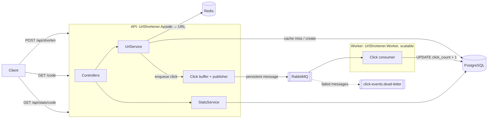

# URL Shortener

[](https://github.com/idanharash/url-shortener/actions/workflows/ci.yml)

A URL shortening service in **ASP.NET Core 10** (.NET 10 LTS) with **PostgreSQL**, **Redis** and **RabbitMQ**.
Redirects are served from a cache, and click counting runs asynchronously so it never slows down or breaks a redirect.

The interesting parts are not the endpoints but the decisions around them: what happens under concurrency,
when a dependency is down, and how accurate the numbers are. Those are documented below, including what is *not* solved yet.

---

## Quick start

Requires **Docker** with Compose v2. The **.NET 10 SDK** is only needed for development and tests.

**1. Clone and create `.env`**

```bash
git clone https://github.com/idanharash/url-shortener.git
cd url-shortener
cp .env.example .env              # Windows cmd: copy .env.example .env
```

**2. Set the two passwords and the API key in `.env`** (required). They are empty on purpose so no secret is committed; choose your own values, `.env` is git-ignored:

```dotenv
POSTGRES_PASSWORD=<choose-a-password>
RABBITMQ_PASSWORD=<choose-another-password>
API_KEY=<at-least-32-characters: openssl rand -hex 32, or on Windows see the full guide>
```

**3. Run and check**

```bash
docker compose up -d --build      # PostgreSQL, Redis, RabbitMQ, Jaeger, migrations, then the API and the Worker
curl http://localhost:5000/health # {"status":"Healthy",...} once everything is up
```

**4. Try it**

```bash
curl -X POST http://localhost:5000/api/shorten -H "X-Api-Key: <API_KEY>" -H "Content-Type: application/json" -d '{"url":"https://example.com"}'
curl -i http://localhost:5000/<code>          # 302 to https://example.com (public, no key needed)
curl http://localhost:5000/api/stats/<code>   # {"createdAt":"…Z","clickCount":1} (counted asynchronously: allow a second)
docker compose down                           # stop (add -v to delete the data)
```

On Windows `cmd` or PowerShell the JSON body needs different quoting; see the full guide.

Swagger: http://localhost:5000/swagger · RabbitMQ UI: http://localhost:15672 · Jaeger: http://localhost:16686

**[Full guide →](docs/getting-started.md)** prerequisites and ports, every `.env` variable, verifying each service, Windows notes, Swagger, stop/restart/reset, running the API outside Docker, and troubleshooting.

---

## Architecture



| Flow | Path |
|---|---|
| **Shorten** | Validate URL → generate random code → `INSERT … ON CONFLICT DO NOTHING` (new code on collision) → cache the mapping |
| **Redirect** | Validate code format → Redis → (miss) PostgreSQL and re-cache → enqueue click → **302** |
| **Click** | In-memory bounded buffer → background publisher (API) → RabbitMQ → consumer (Worker) → atomic `UPDATE` → ack |
| **Stats** | Read from PostgreSQL, the single source of truth for counts |

---

## Design decisions

**302, not 301.** Browsers cache permanent redirects, so repeat visits would never reach the service and would not be counted. A 302 costs one request to us per click; counting clicks is a feature, so that cost is the point.

**Clicks are counted asynchronously.** A redirect only drops the click into an in-memory buffer; a background publisher sends it to RabbitMQ and a consumer applies an atomic `UPDATE … SET click_count = click_count + 1`. Redirect latency doesn't depend on database writes, and write load is smoothed by the queue. The price is **eventual consistency**: stats lag behind by the time a click spends in the buffer and the queue.

**The consumer runs in its own process (`UrlShortener.Worker`).** Redirect traffic and click processing have different load profiles, so they scale separately: more API replicas for traffic, more Worker replicas for queue throughput (`docker compose up -d --scale worker=3`; RabbitMQ spreads messages across consumers, and the atomic `UPDATE` keeps counts exact). A failing or slow Worker never affects redirects; clicks just wait in the queue. The cost is one more deployable; both hosts share the same Infrastructure registrations (`AddPostgres`, `AddClickPublisher`, `AddClickConsumer`, …), so there is no duplicated setup.

**Delivery is at-least-once, and counts are approximate by design.** A message is acked only after the database update, so a crash between the two can count a click twice. Clicks still in the in-memory buffer are lost if the process crashes. For analytics this is accepted; I deliberately did **not** add a transactional outbox, because writing a row per redirect to the database is exactly the cost the queue exists to avoid. Billing-grade counts would need idempotency keys plus an outbox or publisher confirms.

**The cache holds only the immutable mapping.** Redis stores `code → URL`, which never changes once created, so it can't become stale and needs no invalidation. Counts are never cached; an earlier version kept a counter inside the cached entry and it drifted under concurrency. Entries expire (`Cache:EntryTtl`) to bound Redis memory.

**Dependencies are ranked by how much they matter:**

| Dependency down | Behaviour | `/health` |
|---|---|---|
| PostgreSQL | Creating links, stats and cache-miss redirects fail (500); cached redirects keep working; clicks wait in the queue | Unhealthy, 503 |
| Redis | Reads are treated as misses (fail fast, no waiting on timeouts); redirects served from PostgreSQL; rate limiter allows requests | Degraded |
| RabbitMQ | Redirects unaffected; clicks are buffered in memory (up to 10,000, then dropped and counted in `url_clicks_dropped_total`); the consumer reconnects | Degraded |

The consumer requeues messages while the database is unavailable (with a delay, so it slows down rather than spins) and sends malformed or non-retryable messages to a dead-letter queue instead of blocking the queue.

**Short codes: 5 random Base62 characters.** Generated with a CSPRNG (`RandomNumberGenerator.GetString`, unbiased), so codes can't be enumerated sequentially. 62⁵ ≈ 916M possible codes. A collision is handled by `INSERT … ON CONFLICT DO NOTHING` and a new code (up to 5 attempts), with no exception-driven retries. The chance that one insert collides is *n / 916M* for *n* existing links: about 0.1% at 1M links and 1% at 10M. Before reaching tens of millions of links, the code length should grow to 6 (57B codes).

**Retries only for transient errors.** The database pipeline (Polly) retries connection drops and timeouts with exponential backoff and jitter, behind a circuit breaker. Constraint violations and SQL errors are not retried; retrying them only adds latency before the same failure.

**Rate limiting in Redis.** A fixed window per client IP, implemented as one atomic Lua script (`INCR` and `PEXPIRE` together, so a crash can't leave a key without expiry). It's stored in Redis rather than in memory so the limit holds across several instances. It fails open: blocking all users because the limiter's store is down would be worse than briefly allowing extra requests.

**API keys for creating links; redirects and stats stay public.** Link creation is done by machine clients, for which an API key in the `X-Api-Key` header is the standard and simplest fit. It is implemented as a regular ASP.NET Core authentication scheme, so the endpoint only declares `[Authorize]`. Several keys can be valid at once (rotation without downtime), keys must be at least 32 characters, comparison is constant-time over SHA-256 hashes, and the app refuses to start without a key, so the endpoint can't end up unprotected by accident. Authentication runs after the rate limiter, so key guessing is rate limited too. JWT with an identity provider becomes the right choice once there are user accounts ("my links"); because the auth is a pluggable scheme, that is a registration change, not a rewrite.

**NHibernate with targeted raw SQL.** Mappings handle reads; the two operations that must be atomic (insert-if-absent and increment) are single SQL statements. For a model this small, Dapper or EF Core would be equally valid choices.

---

## API

| Endpoint | Success | Errors |
|---|---|---|
| `POST /api/shorten` `{ "url": "…" }`, header `X-Api-Key` | 200 `{ code, shortUrl }` | 400 invalid URL, 401 missing or wrong API key, 429 rate limited (with `Retry-After`) |
| `GET /{code}` | 302 to the original URL | 404 unknown or malformed code |
| `GET /api/stats/{code}` | 200 `{ createdAt, clickCount }` | 404 unknown or malformed code |
| `GET /health` | 200 Healthy/Degraded | 503 Unhealthy (PostgreSQL down) |
| `GET /health/live` | 200 while the process runs | – |

Accepted URLs: absolute `http`/`https`, at most 2048 characters, not pointing at this service.

---

## Configuration

All settings live in [`SharedConfig/appsettings.json`](SharedConfig/appsettings.json) and are validated at startup: a missing or invalid value stops the app with a message naming the setting (never its value). Passwords and API keys are not in the file; they come from `.env` in Docker or from `dotnet user-secrets` locally ([details](docs/getting-started.md#2-clone-and-configure)). Tunable behaviour: `App:PublicBaseUrl`, `RateLimiting:PermitLimit` / `Window`, `Cache:EntryTtl`, `Worker:MetricsPort`, and `OpenTelemetry:ConsoleExporter` (prints every span; debugging only, costs about 4× throughput).

---

## Observability

- **Traces** (OpenTelemetry → Jaeger, services `UrlShortener` and `UrlShortener.Worker`): ASP.NET Core requests plus custom spans for cache, database and messaging, with failures marked as errors.
- **Metrics** (Prometheus):
  - API `/metrics` (port 5000): HTTP request metrics, `url_cache_hits_total`, `url_cache_misses_total`, `url_cache_errors_total`, `url_clicks_published_total`, `url_clicks_dropped_total`.
  - Worker `/metrics` (port 9091): `url_clicks_processed_total`, `url_clicks_dead_lettered_total`.
- **Logs** (Serilog): structured, with trace and span IDs on every line.

---

## Testing

```bash
dotnet test                                   # everything (integration tests need Docker running)
dotnet test UrlShortener.UnitTests            # unit tests only, about 2 seconds, no Docker
dotnet test UrlShortener.IntegrationTests     # integration tests only
```

| Project | What it proves |
|---|---|
| `UrlShortener.UnitTests` | Business rules in isolation: code collisions and the retry limit, cache hit/miss/fallback, rejecting malformed codes without I/O, URL validation (`javascript:`, `file:`, self-referencing URLs), stats. |
| `UrlShortener.IntegrationTests` | The real API and the real Worker against real PostgreSQL, Redis and RabbitMQ (Testcontainers, `WebApplicationFactory`, the production migrations): **500 concurrent redirects produce exactly 500 counted clicks**; shorten → 302 → stats end to end; a code collision returns no row instead of an error; with Redis down, redirects still work and `/health` reports `Degraded`; a malformed queue message lands in the dead-letter queue; invalid URLs get 400 and unknown codes 404. |

CI runs the build and both test projects (GitHub's Linux runners have Docker) and builds both Docker images on every push.

The .NET code analyzers run on every build with the `latest-recommended` rule set (`Directory.Build.props`); the few rules switched off are listed with their reason in `.editorconfig`.

**Benchmark.** `UrlShortenerBenchmark` measures redirect latency end to end (time until the 302 arrives; cache warmed first):

```bash
dotnet run -c Release --project UrlShortenerBenchmark -- http://localhost:5000/<code> 5000 50
```

Results on a laptop (Intel Core i7-1165G7, Windows, Docker Desktop), full stack from `docker compose up` with `ASPNETCORE_ENVIRONMENT=Production`, 5,000 requests, 50 concurrent:

| Throughput | Mean | P50 | P95 | P99 | Max |
|---|---|---|---|---|---|
| 1,425 req/s | 34.9 ms | 30.6 ms | 70.2 ms | 108.3 ms | 194.3 ms |

All 5,000 requests returned 302, and afterwards the link's `clickCount` was exactly **5,020** (5,000 plus 20 warm-up requests), counted by the separate Worker: no click lost or counted twice under concurrency.

Context: the benchmark client, the API and every dependency share one laptop, and requests go through Docker Desktop's port forwarding, so these are end-to-end numbers on a development machine, not server capacity.

Measuring found one real problem: printing every trace span to the console, which used to be on whenever the environment was `Development`, cut throughput by about 4× (376 req/s, P50 118 ms). It is now an explicit opt-in setting (`OpenTelemetry:ConsoleExporter`, off by default).

---

## Known limitations and next steps

In rough priority order:

1. **One database write per click.** Fine for moderate traffic; at high volume the consumer should aggregate clicks and write them in batches (e.g. per-day counters with one upsert per flush).
2. **Rate limiting by remote IP.** Behind a reverse proxy every client shares the proxy's IP. Production needs `ForwardedHeaders` configured with the proxy's address. A fixed window also allows bursts at window edges; a sliding window or token bucket would smooth that.
3. **Dead-lettered messages have no automated replay;** they're inspected and moved manually (RabbitMQ management UI or a shovel).
4. **API keys, not user accounts, and no abuse screening.** Keys identify trusted clients, not users; per-user features ("my links") would need JWT with an identity provider. Rate limits are per IP, not per key, and target URLs aren't checked against malware or phishing lists.
5. **A few major package upgrades are deferred on purpose:** RabbitMQ.Client 7 (a fully async API, so the publisher and consumer need a rewrite), StackExchange.Redis 3, Npgsql 10 and Swashbuckle (or switching to .NET 10's built-in OpenAPI). Each is a breaking change that deserves its own tested change rather than a version bump; the current versions are supported and run on .NET 10.
6. **Every request is traced** (`AlwaysOnSampler`). At higher traffic, switch to parent-based ratio sampling.

---

## Repository structure

```text
UrlShortener.Application     ASP.NET Core API: controllers, middleware, health checks, click publishing
UrlShortener.Worker          Background service: consumes click events and stores them (scales independently)
UrlShortener.BL              Business logic: URL creation, redirects, stats, click handling
UrlShortener.Model           Entities, DTOs and the interfaces the BL depends on
UrlShortener.Infrastructure  PostgreSQL (NHibernate), Redis cache, RabbitMQ publisher/consumer, telemetry, and the DI registrations both hosts share
UrlShortener.Migrations      FluentMigrator schema migrations (separate runner, not on app start)
UrlShortener.UnitTests       Unit tests: business rules in isolation (xUnit, Moq)
UrlShortener.IntegrationTests  Real app against real PostgreSQL/Redis/RabbitMQ (Testcontainers)
UrlShortenerBenchmark        Redirect latency benchmark
SharedConfig/appsettings.json  Settings shared by the API and the migrations runner
Directory.Build.props        Target framework, nullable, analyzers for all projects (.editorconfig tunes the rules)
Dockerfile, Dockerfile.worker, Dockerfile.migrations  Images for the API, the Worker and the migrations runner
docker-compose.yml (+ .override.yml)  Full stack; the override adds migrations and Jaeger
.env.example                 Template for the passwords Docker Compose needs
docs/getting-started.md      Full setup, verification and troubleshooting guide
```
